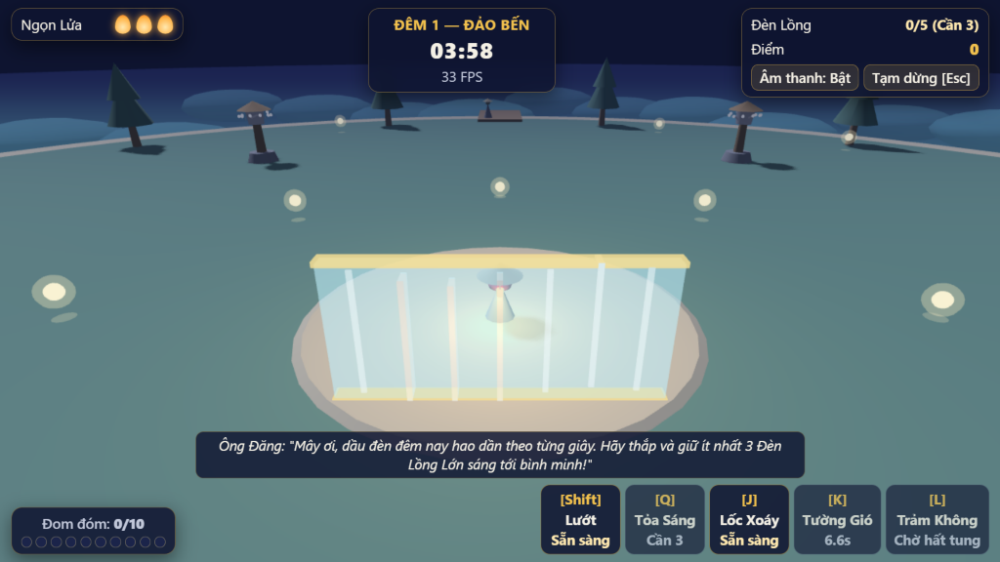
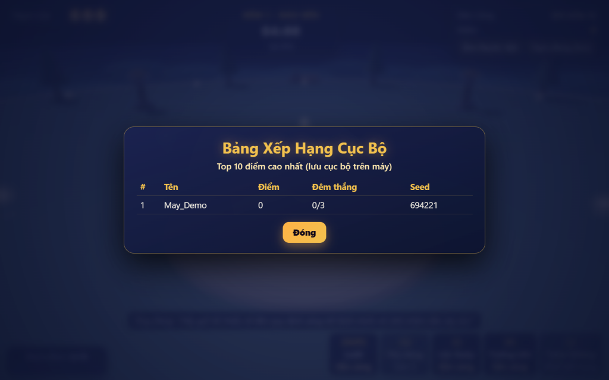

# Đảo Đèn Lồng — Phát hành v1.0.0 (Phase 4 · Contract v1.3)


> **Video demo `.mp4` (< 5 phút):** [Xem / Tải demo.mp4 tại Release v1.0.0](https://github.com/hunter2996/K5-L3A-Day12-NguyenThanhTung-2A202603446-AI-SDLC-Dao-Den-Long/releases/download/v1.0.0/demo.mp4)


Game 3D góc nhìn thứ ba xây dựng bằng **HTML + Three.js r147 (offline)** kết hợp lõi mô phỏng tất định **Node.js (60 tick/giây)** qua 3 Đêm (*Đêm 1: Đảo Bến*, *Đêm 2: Đảo Cau*, *Đêm 3: Đảo Chuông*), tuân thủ đầy đủ [PRD-0.md](PRD-0.md), [Ticket-02.md](Ticket-02.md), [Ticket-03.md](Ticket-03.md), [Ticket-04.md](Ticket-04.md) và **Test Contract v1.3**.





---

## Yêu cầu hệ thống

- **Node.js 18+** (không cần `npm install` hay gói phụ thuộc ngoài — chạy offline 100%).
- Trình duyệt hỗ trợ **WebGL** hiện đại (Chrome / Chromium / Edge / Firefox / Safari). Để chạy chế độ benchmark tự động `src/bench.js`, máy cần có **Google Chrome**, **Chromium** hoặc **Microsoft Edge**.
- Hoặc chạy qua **Docker** với `Dockerfile` đi kèm.

---

## Cài đặt và chạy (tối đa 3 lệnh)

```bash
git clone https://github.com/hunter2996/K5-L3A-Day12-NguyenThanhTung-2A202603446-AI-SDLC-Dao-Den-Long.git
cd K5-L3A-Day12-NguyenThanhTung-2A202603446-AI-SDLC-Dao-Den-Long
npm start
```

- Lệnh `npm start` (`node src/serve.js`) khởi chạy web server cục bộ và tự mở trình duyệt.
- **Chạy bằng Docker:**
  ```bash
  docker build -t dao-den-long:1.0.0 .
  docker run -p 4173:4173 dao-den-long:1.0.0
  ```
- **Đóng gói thư mục tĩnh phát hành cho GitHub Release:**
  ```bash
  node scripts/package-release.js
  ```

---

## Kiểm tra, Headless, Benchmark, Soak & Bảng xếp hạng (Contract v1.3)

```bash
npm run build
npm test
node src/headless.js --seed 1 --night 3 --ticks 18000 --out out.jsonl
node src/bench.js --seed 42 --duration 30 --out bench.json
node --jitless --max-semi-space-size=1 --expose-gc src/soak.js --seed 7 --nights 10 --out soak.json
node src/serve.js --export-leaderboard out.json
```

- **Ghi chú về VSync trong Benchmark (`src/bench.js`):** Engine chạy trên WebGL trong cửa sổ Chromium `1280×720` kèm cờ `--disable-frame-rate-limit --disable-gpu-vsync` (`vsync_off: true`, đạt **`88.3 avg FPS` / `30.8 p1_low FPS` / `1745 ms load`** trên Intel Iris Xe). Trường hợp trình điều khiển đồ họa hoặc compositor của hệ điều hành cưỡng bức khóa tốc độ khung hình ở tần số màn hình, tốc độ khung hình tối đa sẽ theo giới hạn của compositor máy chạy.
- **Bảng xếp hạng cục bộ:** Lưu trực tiếp trên đĩa (`~/.dao-den-long/leaderboard.json`, hoặc biến môi trường `LEADERBOARD_FILE`), giữ top `10` theo điểm giảm dần (bằng điểm xếp theo đạt trước đứng trên).

---

## Điều khiển & Khả năng tiếp cận

Tất cả các phím hành động cốt lõi đều có thể **đổi trong mục Cài đặt** (tự động báo trùng phím, có nút **"Khôi phục mặc định"** và lưu qua `localStorage`):

| Phím mặc định                           | Chức năng                                                                                                                |
| ------------------------------------------- | -------------------------------------------------------------------------------------------------------------------------- |
| `W A S D` / `↑ ↓ ← →`               | Di chuyển Mây (`6.0 m/s`, `7.2 m/s` khi có Bùa Gió)                                                               |
| `Space`                                   | Nhảy (`7.0 m/s`, trọng lực `-20 m/s²`)                                                                             |
| `Shift`                                   | **Lướt (Dash)** — `14 m/s` trong `0.2 s`, hồi `1.5 s`                                                      |
| `E` / `F`                               | Thắp đèn mới (`10`), thắp lại (`5`) hoặc châm dầu cho đèn đang sáng                                       |
| `Q` / `Chuột phải`                    | **Tỏa Sáng** — tốn `3` đom đóm, bán kính `5 m`, choáng `120` tick                                    |
| `J` / `K` / `L`                       | **Lốc Xoáy Mini** / **Tường Gió** / **Trảm Không** *(kỹ năng sáng tạo trên trình duyệt)* |
| `Esc` / `P`                             | Tạm dừng / Tiếp tục                                                                                                    |
| `Kéo chuột trái` / `Z X` / `Cuộn` | Xoay & thu phóng camera 3D                                                                                                |

**Tùy chọn Tiếp cận (Cài đặt):**

- **Bảng màu dễ phân biệt (Mù màu):** Bóng Mực đổi từ `#7A3CFF` sang `#00B3FF`, cảnh báo UI đổi từ `#FF5A5F` sang `#FFFFFF` kèm `⚠`; đèn tắt bị xẹp `20%` và rách giấy để phân biệt không cần màu.
- **Phụ đề / chỉ báo hình ảnh:** Hiện phụ đề & mũi tên chỉ hướng khi Bóng Mực xuất hiện, cảnh báo gió sắp thổi, `10 s` cuối và đèn `< 30` fuel.
- **Giảm chuyển động:** Tắt rung camera, chớp màn hình và nhấp nháy đồng hồ.
- **Cỡ chữ UI `≥ 18 px` (ở `1280×720`) & Chữ lớn (`×1.25`).**

---

## Sáng tạo của tôi

Toàn bộ yếu tố sáng tạo chỉ chạy ở tầng trình diễn ([index.html](index.html), [src/game.js](src/game.js)), **tắt hoàn toàn trong `headless`, `bench` và `soak`**:

1. **Cụ Đò & Bến Thuyền** ở rìa Đảo Bến cùng lời dẫn chuyện của Ông Đăng qua 3 Đêm.
2. **Bộ kỹ năng Phong Linh (`J` / `K` / `L`):** `[J]` Lốc Xoáy Mini hất tung Bóng Mực, `[K]` Tường Gió chặn Bóng Mực & Gió Lạc, `[L]` Trảm Không lao chém khi địch đang bay trên không.
3. **Nhạc nền ngũ cung & SFX Web Audio tổng hợp** (`CozyAudio`), hoàn toàn phi bản quyền.

**Bằng chứng phần lõi & phát hành v1.0.0:** `npm test` đạt **25/25 PASS**, `bench.json` đạt `88.3` avg FPS / `30.8` p1_low / `1745 ms` load, `soak.json` đạt `0` crash / `32.1 → 34.8 MB`. Chi tiết tại [docs/proof/phase-4.md](docs/proof/phase-4.md).

---

## Tài liệu & Ghi chép

- Đặc tả & Hợp đồng: [PRD-0.md](PRD-0.md) · [Ticket-02.md](Ticket-02.md) · [Ticket-03.md](Ticket-03.md) · [Ticket-04.md](Ticket-04.md) · [game.contract.json](game.contract.json)
- Quyết định thiết kế, Changelog & Retro: [CHANGELOG.md](CHANGELOG.md) · [docs/notes/adr-phase3.md](docs/notes/adr-phase3.md) · [docs/notes/retro.md](docs/notes/retro.md)
- Harness & Nhật ký AI: [AGENTS.md](AGENTS.md) · [docs/notes/ai-log.md](docs/notes/ai-log.md) · [.agents/skills/verify-phase4/SKILL.md](.agents/skills/verify-phase4/SKILL.md)
- Bằng chứng 4 Phase: [phase-1.md](docs/proof/phase-1.md) · [phase-2.md](docs/proof/phase-2.md) · [phase-3.md](docs/proof/phase-3.md) · [phase-4.md](docs/proof/phase-4.md)
- Bản quyền & Nguồn: [LICENSE](LICENSE) · [CREDITS.md](CREDITS.md)
