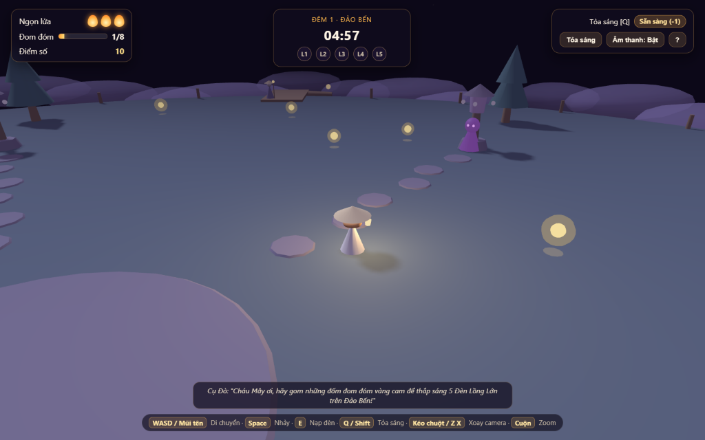

# Bằng chứng kiểm chứng — Phase 1 (Đêm 1: Đảo Bến)

## 1. Bảng truy vết yêu cầu

| Yêu cầu (PRD-0 & Contract) | Cách kiểm chứng | Bằng chứng | Kết quả |
|---|---|---|---|
| Đồng bộ `game.contract.json` và `src/sim.js` | So khớp trực tiếp `DEFAULT_TUNING` với `game.contract.json` | `tests/run_tests.js` test #1 | Đạt |
| Mô hình tick 60Hz, chuẩn hóa `move`, xoay `cam_yaw_deg`, nhảy `Y` | Kiểm tra bước tick & phép biến đổi vector + nhảy | `tests/run_tests.js` test #2 | Đạt |
| Nhặt đom đóm (`mote_picked`) & nạp thắp đèn (`deposit`, `lantern_lit`) | Headless CLI với `s1_pickup_deposit.json` + `s1_inputs.json` | `tests/run_tests.js` test #3 | Đạt |
| Tỏa sáng (`pulse`) làm choáng & đẩy lùi Bóng Mực trong `pulse_radius` | Headless CLI với `s2_pulse_stun.json` + `s2_inputs.json` | `tests/run_tests.js` test #4 | Đạt |
| Vùng an toàn `safe_radius` quanh đèn đã thắp & không phát event khi dựng scenario | Headless CLI với `s3_safe_radius.json` (300 ticks) | `tests/run_tests.js` test #5 | Đạt |
| Va chạm Bóng Mực (`player_hit`), rớt đom đóm, miễn nhiễm `2.0s` & thua (`no_flames`) | Headless CLI với `s4_hit_and_loss.json` (400 ticks) | `tests/run_tests.js` test #6 | Đạt |
| Thắp đủ 5 đèn thắng (`all_lit`) + cộng thưởng thời gian & ngọn lửa | Headless CLI với `s5_win_all_lit.json` + `s5_inputs.json` | `tests/run_tests.js` test #7 | Đạt |
| Hết giờ đêm thua (`dawn`) đúng tick cuối | Headless CLI với `time_left_s: 1.0` (120 ticks) | `tests/run_tests.js` test #8 | Đạt |
| Tính tất định (`--seed 42` chạy 2 lần giống hệt nhau) | So sánh từng byte output JSONL (cả bản mặc định & bản kích hoạt `shade_spawned` tại tick 2700) | `tests/run_tests.js` test #9 | Đạt |
| Lỗi định dạng `inputs`/`scenario` trả exit code `2` + stderr | Chạy CLI với tick trùng, JSON hỏng, `--night 2` | `tests/run_tests.js` test #10 | Đạt |
| Skill sáng tạo: gọi sấm sét (`J`) làm choáng & đẩy lùi Bóng Mực không đổi đầu ra headless | Kiểm tra `triggerCreativeLightning` + nhấn `KeyJ` trên trình duyệt | `tests/run_tests.js` test #11 & [phase-1-lightning.png](phase-1-lightning.png) | Đạt |
| Game 3D HTML hiển thị Mây đội nón lá treo đèn, Đảo Bến, đom đóm, Bóng Mực, HUD, di chuyển & nhảy | Chạy `npm start` (`http://127.0.0.1:4173/`) và kiểm tra trên trình duyệt thật | [phase-1-gameplay.png](phase-1-gameplay.png) | Đạt |

## 2. Kết quả chạy kiểm tra tự động

```text
> npm run build
node --check src/sim.js src/headless.js src/serve.js src/game.js tests/run_tests.js

> npm test
PASS: game.contract.json matches sim.DEFAULT_TUNING exactly
PASS: Tick model, camera yaw transform, normalization, and jump physics
PASS: Scenario 1: pickup motes and deposit to light L1 via headless CLI
PASS: Scenario 2: pulse stuns & pushes shade within pulse_radius, costs 1 mote, and recovers
PASS: Scenario 3: lit lantern safe_radius keeps Shades out and emits no setup events
PASS: Scenario 4: player_hit drops carried motes, invuln window works, and no_flames loses
PASS: Scenario 5: lighting final lantern wins immediately with bonus score
PASS: Dawn timeout stops at exact tick when time_left_s hits 0
PASS: Determinism: same seed produces byte-for-byte identical JSONL output (including shade_spawned)
PASS: Error handling: malformed inputs/scenario exit with code 2
PASS: Creative browser skill triggerCreativeLightning stuns/pushes nearby Shades without altering score or headless

Summary: 11 passed, 0 failed
```

## 3. Ảnh chụp kiểm chứng giao diện 3D & HUD



![Skill gọi sấm sét [J] — Hồi chiêu 5.3s](phase-1-lightning.png)

- Trình duyệt tải `http://127.0.0.1:4173/` không có lỗi console hay page error.
- Mây đội nón lá có treo đèn lồng nhỏ chiếu sáng mặt đất, di chuyển bằng `W/D` + `Space` nhặt 1 đom đóm (`Đom đóm: 1/8`, `Điểm số: 10`, `Tỏa sáng [Q]: Sẵn sàng (-1)`), đồng hồ đếm ngược (`04:57`), đủ 3 ngọn lửa và 5 đèn `L1`–`L5`.
- Nhấn phím `J` kích hoạt skill **Sấm sét** trên trình duyệt và chuyển trạng thái `Sấm sét [J]` sang đếm ngược hồi chiêu (`5.3s`).
