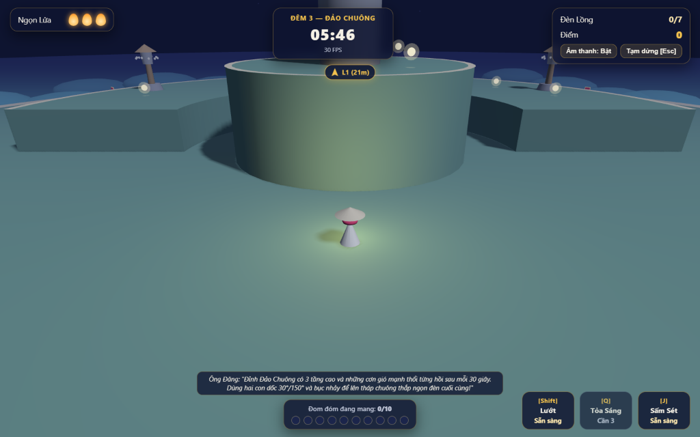
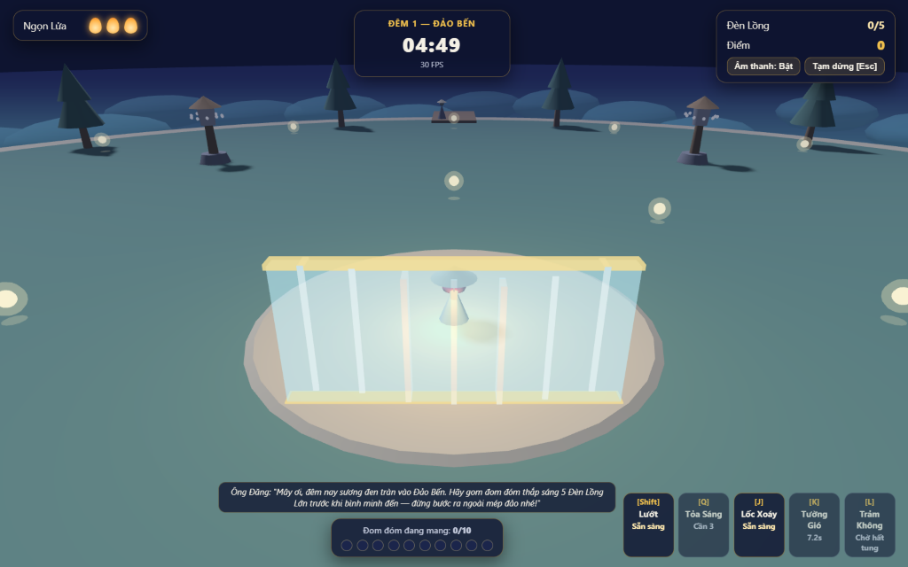

# Bằng chứng kiểm chứng — Phase 2 (3 Đêm & Test Contract v1.1)

## 1. Bảng truy vết DoD & Yêu cầu Ticket-02

| Yêu cầu (Ticket-02 & DoD) | Cách kiểm chứng | Bằng chứng | Kết quả |
|---|---|---|---|
| Đồng bộ `contract_version: "1.1"` & số liệu chuẩn trong `game.contract.json` và `src/sim.js` | So khớp trực tiếp toàn bộ khóa `tuning` chuẩn | `tests/run_tests.js` test #1 | Đạt |
| Regression Phase 1 với số liệu chuẩn (6.0 m/s, 10 đom đóm, Pulse 3D 5m, `safe_radius` 6m đẩy ≤30 tick, recoil 60 tick, thưởng thắng) | Chạy lại 6 test regression trên `src/headless.js` | `tests/run_tests.js` tests #2–#7 | Đạt |
| Lướt (`Dash`): `14 m/s`, `12` tick (`2.8m`), hồi `1.5s`, giữ độ cao trên không | Headless CLI với `s6_dash_inputs.json` | `tests/run_tests.js` test #8 | Đạt |
| Rơi khỏi đảo (`Y < -10`): bỏ qua bất tử, thêm `lost`, chờ `60` tick hồi sinh | Headless CLI với `s7_fall_scenario.json` | `tests/run_tests.js` test #9 | Đạt |
| Đêm 2 (*Đảo Cau*): hai đảo, cầu tre, bục nhảy `(20,0,18)` đáp sang Đảo B | Headless CLI `--night 2` với `s8_night2_launchpad.json` | `tests/run_tests.js` test #10 | Đạt |
| Đêm 3 (*Đảo Chuông*): 3 tầng, dốc `30°`/`150°`, bục nhảy lên Tầng 2, Tháp chuông, gió mạnh tick `1800` | Headless CLI `--night 3` với `s9_night3_launchpad_wind.json` | `tests/run_tests.js` test #11 | Đạt |
| Gió Lạc (`idle`→`chase`→`drifter_steal`→`flee`→`drifter_drop`) & Bùa Gió (`7.2 m/s`, 0s dash cd) | Headless CLI `--night 2` với `s10_drifter_charm.json` | `tests/run_tests.js` test #12 | Đạt |
| Tạm dừng (`paused` / `resumed`): đóng băng `sim_tick` và đồng hồ trong khi `tick` vẫn tăng | Headless CLI với `s11_pause_inputs.json` | `tests/run_tests.js` test #13 | Đạt |
| Tính tất định & mã thoát `2` khi file đầu vào sai định dạng | Chạy 2 lần `--seed 42 --night 2 --ticks 1400` + kiểm tra tick trùng / `--night 4` | `tests/run_tests.js` test #14 | Đạt |
| Hiệu năng headless 1 Đêm đầy đủ (`21.600` tick `≤ 30 s`) | Đo thời gian chạy `node src/headless.js --seed 99 --night 3 --ticks 21600` | `tests/run_tests.js` test #15 (`131 ms` trên Node v24.13.0) | Đạt |
| Phần sáng tạo (`J` Lốc Xoáy, `K` Tường Gió, `L` Trảm Không, Cụ Đò, nhạc Web Audio) không đổi đầu ra contract | Test headless 16/16 + kiểm tra thực tế `J`/`K`/`L`/`Shift` trên trình duyệt `1280×720` | [phase-2-skills.png](phase-2-skills.png) | Đạt |
| Bản 3D `1280×720`: Menu, Giới thiệu Ông Đăng, Đêm 1/2/3, Cài đặt `localStorage`, Tạm dừng, HUD, FPS `≥ 30` | Kiểm tra trực tiếp trên trình duyệt tại `1280×720` | [phase-2-night3.png](phase-2-night3.png) (`30–60 FPS`, 0 lỗi JS) | Đạt |

## 2. Kết quả chạy kiểm tra tự động

```text
> npm run build
node --check src/sim.js src/headless.js src/serve.js src/game.js tests/run_tests.js

> npm test
PASS: Contract v1.1: game.contract.json matches sim.DEFAULT_TUNING & required keys
PASS: Regression: Tick model, accel<=0.1s, yaw transform, normalization & jump (vy=7, g=-20)
PASS: Regression Scenario 1: pickup 10 motes (no pickup score) and deposit to light L1 (+200)
PASS: Regression Scenario 2: 3D Light Pulse (-3 motes, <=5m, 120-tick stun, 15-tick 4m push, +5 score)
PASS: Regression Scenario 3: safe_radius pushes Shades out within <=30 ticks and prevents hits
PASS: Regression Scenario 4: hit drops motes onto 1.5-2.5m ring (TTL 480), recoil 60 ticks, invuln 90 ticks
PASS: Regression Scenario 5: lighting final lantern wins with standard bonus (floor(time)*2 + flames*50)
PASS: Phase 2 Feature — Dash: 14 m/s for 12 ticks (2.8m), cooldown 1.5s, air dash preserves height
PASS: Phase 2 Feature — Fall off island (Y < -10): ignores invuln, emits lost, waits 60 ticks, respawns at (0,0,0)
PASS: Phase 2 Feature — Night 2 (Đảo Cau): launchpad launches from (20,0,18) across gap onto Island B
PASS: Phase 2 Feature — Night 3 (Đảo Chuông): launchpad to Tier 2, ramps, Bell Tower & Strong Wind
PASS: Phase 2 Feature — Gió Lạc (Drifter) steals & drops on Pulse + Bùa Gió (Wind Charm) gives 7.2 m/s & zero dash cd
PASS: Phase 2 Feature — Pause/Resume freezes sim_tick & time_left_s while tick advances
PASS: Determinism & Error Handling: identical seed output + exit code 2 on invalid JSON/frames
  [Perf] Night 3 21,600 ticks completed in 131 ms
PASS: Performance: Headless full Night 3 (21,600 ticks) finishes in <= 30s
PASS: Creative browser skill triggerCreativeLightning leaves contract score/headless untouched

Summary: 16 passed, 0 failed
```

## 3. Ảnh chụp kiểm chứng bản 3D `1280×720`





- Hiển thị rõ Mây, 3 tầng Đảo Chuông, Bùa Gió, Đèn Lồng, Bóng Mực cầu tím mờ, Tường Gió (`K`), thanh 10 ô đom đóm, đủ 5 ô kỹ năng `[Shift]` Lướt / `[Q]` Tỏa Sáng / `[J]` Lốc Xoáy / `[K]` Tường Gió / `[L]` Trảm Không (chỉ mở khi địch bị hất tung), mũi tên chỉ đèn không đè lên đồng hồ, và chỉ số `#hud-fps` đạt `30–60 FPS` khi chơi ở `1280×720` với 0 lỗi console.
