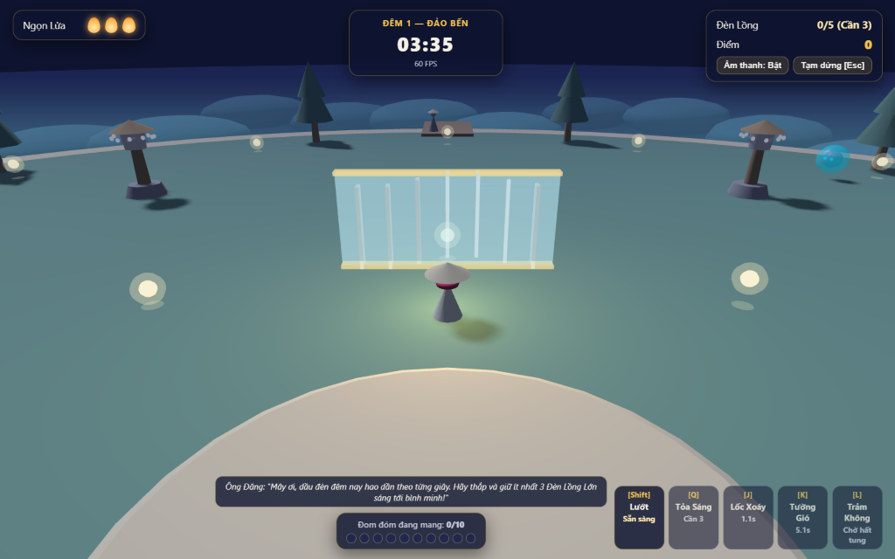

# Bằng chứng kiểm chứng Phase 3 — Đảo Đèn Lồng (Contract v1.2)

- **Phạm vi:** Change Request `"Đèn cạn dầu"` ([Ticket-03.md](../../Ticket-03.md)) & **Test Contract v1.2** ([game.contract.json](../../game.contract.json)).
- **Tài liệu thiết kế & phá vỡ tương thích:**
  - ADR-003: [docs/notes/adr-phase3.md](../notes/adr-phase3.md)
  - Changelog v1.1 -> v1.2: [docs/notes/changelog-phase3.md](../notes/changelog-phase3.md)
  - Nhật ký AI & Harness: [docs/notes/ai-log.md](../notes/ai-log.md)

## 1. Kiểm tra tự động & Regression Headless (`npm run build && npm test`)

Chạy xác nhận cú pháp (`node --check` trên `src/sim.js`, `src/headless.js`, `src/serve.js`, `src/game.js`, `tests/run_tests.js`) và toàn bộ **22 bài kiểm tra** trong [tests/run_tests.js](../../tests/run_tests.js):

1. **Contract v1.2:** Khớp tuyệt đối giữa [game.contract.json](../../game.contract.json) và `sim.DEFAULT_TUNING` (`240 / 270 / 300 s`, `fuel_max: 100`, `relight_cost: 5`, `capacity_max: 20`, `win_ratio: 0.6`, `drain_per_s: 5`, `low_fuel_threshold: 30`, `score.per_mote: 5`, `score.per_second_left: 0`).
2. **Regression Phase 1 & 2:** Toàn bộ kiểm tra vật lý di chuyển/nhảy, Lướt (`14 m/s`, giữ độ cao trên không), rơi khỏi đảo, bục nhảy Đêm 2/3, gió Đêm 3, Gió Lạc, Bùa Gió, Pause/Resume, tất định cùng seed, mã thoát `2` khi sai input/scenario và hàm sáng tạo `triggerCreativeLightning` vẫn đạt 100%; các test cũ bị `[THAY THẾ]` (`per_mote = 5`, bỏ thắng sớm `all_lit`, Contract `v1.2`) đã được cập nhật kèm ghi chú rõ ràng.
3. **Tính năng mới Phase 3 (`P3-1` đến `P3-6`):**
   - `P3-1`: Hao hụt số nguyên `1/60` chính xác, sự kiện `lantern_out` (`deposited = 0`, `ever_lit = true`), thắp lại `5` đom đóm (`relight: true`, `+40`).
   - `P3-2`: Châm dầu `ceil((100 - fuel) / 10)`, bỏ qua đèn đầy (`used = 0`), khôi phục vùng an toàn `6 m` khi lên `>= 30` và đẩy Bóng Mực ra trong `<= 30` tick không gây sát thương.
   - `P3-3`: Mốc `30` vs `< 30`, Bóng Mực `wander -> drain` (`5/s` hút cộng dồn, ghi `fuel_drain` mỗi `60` tick), chuyển `chase <= 6 m`, Tỏa Sáng trúng `drain` thưởng `+15` và hết choáng luôn về `wander`.
   - `P3-4`: Sức chứa tăng dần `min(20, 10 + 2 * successful_lights)` (bỏ qua đèn đặt sẵn của scenario).
   - `P3-5`: Ngưỡng thắng bình minh (`3/5`, `4/6`, `5/7`), thưởng `50 + floor(fuel)` mỗi đèn sáng + `50` mỗi Ngọn Lửa, không thưởng thời gian, ưu tiên thua `no_flames` ngay cả ở tick bình minh cuối.
   - `P3-6`: Lỗi định dạng scenario v1.2 trả mã thoát `2`.
4. **Hiệu năng Đêm 3 (`18.000` tick / `300 s`):** Hoàn thành trong **`≤ 0.4 s`** (dưới xa ngưỡng `30 s`).

## 2. Kiểm chứng bản 3D trình duyệt ở `1280x720`

Kiểm tra trực tiếp qua server cục bộ `node src/serve.js --no-open` trên viewport `1280x720`:
- **0 lỗi console / 0 lỗi runtime JS** trong suốt lúc tải trang, đổi cài đặt, reload trang và điều khiển nhân vật.
- **Chế độ mù màu (`"Bảng màu dễ phân biệt"`):** Lưu thành công vào `localStorage` qua reload; `document.body` giữ lớp `colorblind`, Bóng Mực chuyển viền & mắt sang `#00B3FF` (thay `#7A3CFF`), cảnh báo UI dùng `#FFFFFF` + `⚠`.
- **Phân biệt không cần màu & HUD Phase 3:** Đèn tắt xẹp `20%` chiều dọc kèm vết rách giấy, đồng hồ Đêm 1 bắt đầu `04:00`, bộ đếm `0/5 (Cần 3)`, thanh đom đóm `0/10`, nhân vật phụ Cụ Đò & bộ kỹ năng `[Shift]` Lướt / `[Q]` Tỏa Sáng / `[J]` Lốc Xoáy / `[K]` Tường Gió / `[L]` Trảm Không hoạt động bình thường.

