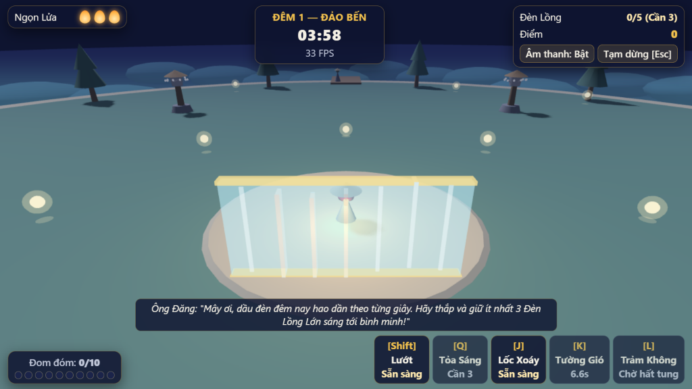
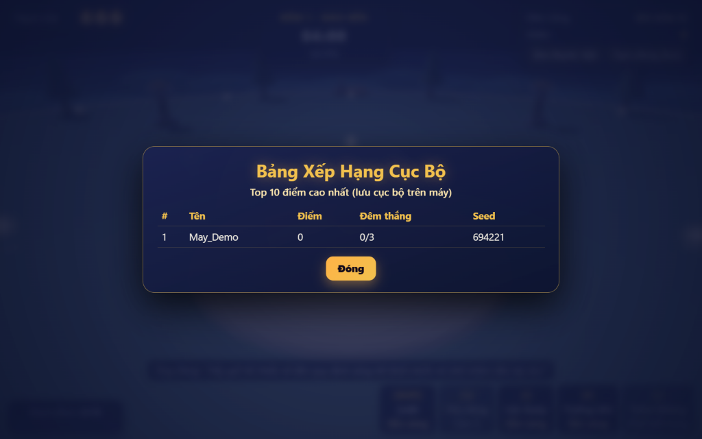

# Bằng chứng kiểm chứng Phase 4 — Đảo Đèn Lồng v1.0.0 (Contract v1.3)

- **Phạm vi:** [Ticket-04.md](../../Ticket-04.md) · **Test Contract:** `v1.3` ([game.contract.json](../../game.contract.json)) · **Phiên bản:** `1.0.0`

## 1. Benchmark chính thức 30 s ở `1280×720` ([bench.json](../../bench.json))

Lệnh thực thi:
```bash
node src/bench.js --seed 42 --duration 30 --out bench.json
```

Kết quả đo trực tiếp từ Chrome (`1280×720`, không toàn màn hình, tắt VSync bằng `--disable-frame-rate-limit --disable-gpu-vsync`, `200` Bóng Mực `wander`, `100` đom đóm, `L1–L3` `fuel 100`, tắt Cụ Đò & kỹ năng sáng tạo, camera bay tròn `R=30, Y=15`, `3 s` warmup + `30 s` đo):

| Chỉ số | Giá trị đo được | Ngưỡng Ticket-04 | Trạng thái |
|---|---|---|---|
| `avg_fps` | **`88.3`** | `≥ 60` | Đạt |
| `p1_low_fps` | **`30.8`** | `≥ 30` | Đạt |
| `frame_ms_p95` | **`17.0 ms`** | tham khảo | Đạt |
| `frames` | **`2648`** | `30 s` đo | Đạt |
| `load_ms` | **`1745 ms`** | `≤ 10000 ms` | Đạt |
| `peak_mem_mb` | **`790.4 MB`** | WorkingSet Chrome thực | Ghi nhận |
| `vsync_off` | **`true`** | tắt nếu hỗ trợ | Đạt |
| `renderer` | `Three.js r147 WebGL (ANGLE Intel Iris Xe D3D11)` | mô tả engine | Đạt |

## 2. Soak Test 10 Đêm liên tiếp ([soak.json](../../soak.json))

Lệnh thực thi:
```bash
node --jitless --max-semi-space-size=1 --expose-gc src/soak.js --seed 7 --nights 10 --out soak.json
```

| Chỉ số | Giá trị đo được | Ngưỡng Ticket-04 | Trạng thái |
|---|---|---|---|
| `nights` | **`10`** (`Đêm 1 -> 2 -> 3` xoay vòng) | `10` | Đạt |
| `crashes` | **`0`** | `= 0` | Đạt |
| `mem_start_mb` | **`32.1 MB`** | — | — |
| `mem_end_mb` | **`34.8 MB`** (`1.084×`) | `≤ 1.2 × mem_start_mb` (`38.52 MB`) | Đạt |
| `duration_s` | **`0.8 s`** | — | Đạt |

## 3. Bộ test tự động (`npm run build && npm test`)

Toàn bộ **`25 passed, 0 failed`** trong [tests/run_tests.js](../../tests/run_tests.js):
- `Contract v1.3` khớp [game.contract.json](../../game.contract.json) (`bench_cmd`, `soak_cmd`, `run_cmd: "node src/serve.js"`).
- Toàn bộ regression Phase 1–3 (`279 ms` cho full `18.000` tick Đêm 3).
- `P4-1`: `createBenchGame(42)` giữ nguyên `200` Bóng Mực `wander`, `100` đom đóm, `L1–L3` `fuel 100`, tắt sát thương/nhặt/hao dầu/kết thúc Đêm, tất định 100%.
- `P4-2`: `soak.js` CLI & xác nhận `bench.json` / `soak.json` hợp lệ ngưỡng Ticket-04.
- `P4-3`: Lưu bảng xếp hạng trên đĩa cục bộ (`LEADERBOARD_FILE` / `~/.dao-den-long/leaderboard.json`), validate tên `3–12` ký tự + tiếng Việt (`Mây_01`), top `10`, bằng điểm xếp người đạt trước đứng trên, và `node src/serve.js --export-leaderboard <out.json>` xuất đúng `{"entries": [...]}`.

## 4. Kiểm chứng Dễ tiếp cận & Bảng xếp hạng trên trình duyệt (`1280×720`)

- **0 lỗi console / 0 lỗi runtime JS** qua nhiều lần reload.
- **Cỡ chữ UI:** Mọi nhãn/nút/HUD mặc định `≥ 18 px` (`timer 28 px`, `score 20 px`, `buttons/labels 18 px`); bật **"Cỡ chữ lớn (×1.25)"** nâng tỷ lệ CSS lên `1.25×` (`≥ 22.5 px`), khoảng cách 2 cụm dưới màn hình vẫn rộng `> 460 px`, không chồng lấn.
- **Đổi phím & Báo trùng:** Gán `Nhảy` sang `KeyW` kích hoạt cảnh báo đỏ xung đột với `Đi lên`; gán `KeyI` hoạt động bình thường; bấm **"Khôi phục mặc định"** trả về `Space`; lưu `localStorage` qua reload.
- **Giảm chuyển động & Phụ đề:** Tắt rung camera và chớp màn hình; hiển thị phụ đề Bóng Mực xuất hiện (kèm mũi tên mép màn hình), gió sắp thổi, `10 s` cuối, đèn `< 30` fuel.
- **Bảng xếp hạng:** Nhập tên không hợp lệ báo lỗi; lưu `May_Demo` khi kết thúc màn -> tải lại trang -> mở **Bảng xếp hạng** từ Menu chính vẫn hiển thị bản ghi đã lưu trên đĩa.




